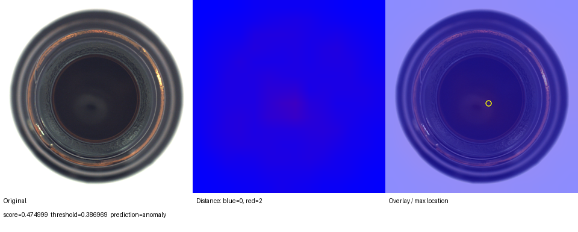
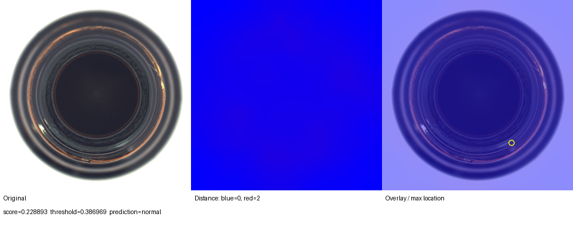

# Industrial Defect Inspector

基于冻结 ResNet18 局部特征与正常特征最近邻检索的瓶口外观异常检测项目。
支持单图命令行推理、距离热力图和本地 Streamlit 页面。

## 方法

```text
167 张正常图 → ResNet18 layer3 → 32732 个 256 维归一化局部特征
待测图 → 196 个局部特征 → 最近正常特征的欧氏距离 → 最大值作为图像分数
42 张正常验证图 → 95% 分位数阈值 → score > threshold 判异常
```

冻结 ImageNet 预训练权重，不更新参数。这是简单最近邻基线，不是完整 PatchCore。
整图缩放至 224×224；热力图由 14×14 距离图插值

## 原始基线结果

MVTec AD bottle 官方测试集 83 张图；测试前用正常验证集固定阈值 0.3869686887。

| Precision | Recall | F1 | 正常图误报率 | TN / FP / FN / TP |
|---:|---:|---:|---:|---|
| 98.44% | 100% | 99.21% | 5% | 19 / 1 / 0 / 63 |

### 误报与正常对照

正常图 006 被误报，score=0.474999；正常图 014，score=0.228893。
固定色标 0～2；黄圈是最大距离网格中心，不是精确缺陷边界。




原图来自 MVTec AD，MVTec Software GmbH。派生可视化：CC BY-NC-SA 4.0。

## 安装（Windows / PowerShell）

原始验证环境：Python 3.12.10、RTX 5080、PyTorch 2.14.1+cu130、torchvision 0.29.1+cu130。
在项目根目录执行：

```powershell
python -m venv .venv
.\.venv\Scripts\python.exe -m pip install -r requirements-demo.txt
.\.venv\Scripts\python.exe scripts\check_environment.py
```

requirements.txt 固定核心依赖，requirements-gpu.txt 添加 CUDA 13.0 官方源，
requirements-demo.txt 增加 Streamlit。首次建库联网下载 ImageNet 权重至 .cache/torch。
环境或平台不同需选择匹配的官方依赖并重新验证。

## 数据准备与复现

[官方数据页](https://www.mvtec.com/research-teaching/datasets/mvtec-ad)。
本次官方 bottle 链接失效，使用 [公开镜像](https://huggingface.co/datasets/foersben/mvtec-ad/tree/main/bottle)。
357 个文件大小与镜像清单核对通过，未核对官方压缩包哈希。

```text
data/mvtec_ad/bottle/
  train/good/                  209 张正常图
  test/good/                    20 张正常图
  test/{各缺陷类型}/             63 张缺陷图
  ground_truth/{各缺陷类型}/     63 张掩码
```

原始数据、预训练权重、特征库、缓存和虚拟环境不上传；仓库保留派生示例图、许可和结果。

```powershell
.\.venv\Scripts\python.exe scripts\inspect_data.py
.\.venv\Scripts\python.exe scripts\prepare_splits.py
.\.venv\Scripts\python.exe scripts\build_memory_bank.py
.\.venv\Scripts\python.exe scripts\calibrate_threshold.py
.\.venv\Scripts\python.exe scripts\evaluate_baseline.py
```

按 seed=42 划分 167 张建库、42 张验证；官方测试集完整保留。
重建特征库后按顺序重新校准，不随意混用历史阈值。
已有本机特征库则无需重新建库。

## 单图推理

```powershell
.\.venv\Scripts\python.exe scripts\predict.py --image data/mvtec_ad/bottle/test/good/006.png
```

输出到 outputs/predictions，包含 PNG、JSON 和原始距离图。
支持 --device auto/cuda/cpu、--artifacts、--output-dir；CPU 推理尚未在本项目验收。
异常分数不是缺陷概率。

## 本地页面

```powershell
.\.venv\Scripts\python.exe -m streamlit run app.py
```

访问 http://127.0.0.1:8501，上传图片并点击检测。
显示判断、分数、固定阈值和三张图，支持下载结果。
默认仅绑定本机，图片不写入数据集，不自动学习。
仓库已包含误报与正常对照分析图；Streamlit 页面截图可另存至 docs/images。

## 代码结构

```text
app.py                        Streamlit 页面
scripts/core.py               公共预处理、提取器、评分、渲染
scripts/predict.py            单图 CLI
scripts/build_memory_bank.py  建库
scripts/calibrate_threshold.py 阈值校准
scripts/evaluate_baseline.py  图像级测试
scripts/verify_refactor.py    与归档基线比对
docs/                        结果、实验记录、许可、示例图
```

## 局限

- 仅验证瓶口俯视图；反光、光照和位置变化可能误报。
- 只有 20 张正常测试图，误报率估计不稳定。
- 正常验证集无法评估缺陷召回。
- 最大局部距离对孤立高分敏感；最近邻忽略位置约束。
- 未评估像素级精度、推理延迟或跨产品泛化。

## 来源与许可

MVTec AD: Paul Bergmann et al., “MVTec AD — A Comprehensive Real-World Dataset for Unsupervised Anomaly Detection”, CVPR 2019。
数据和派生示例图采用 CC BY-NC-SA 4.0，仅用于非商业学习/研究，保留署名并按相同许可共享。
[完整数据许可](docs/DATA_LICENSE.txt)。预训练权重来自 torchvision 官方发布，遵守相应条款。

